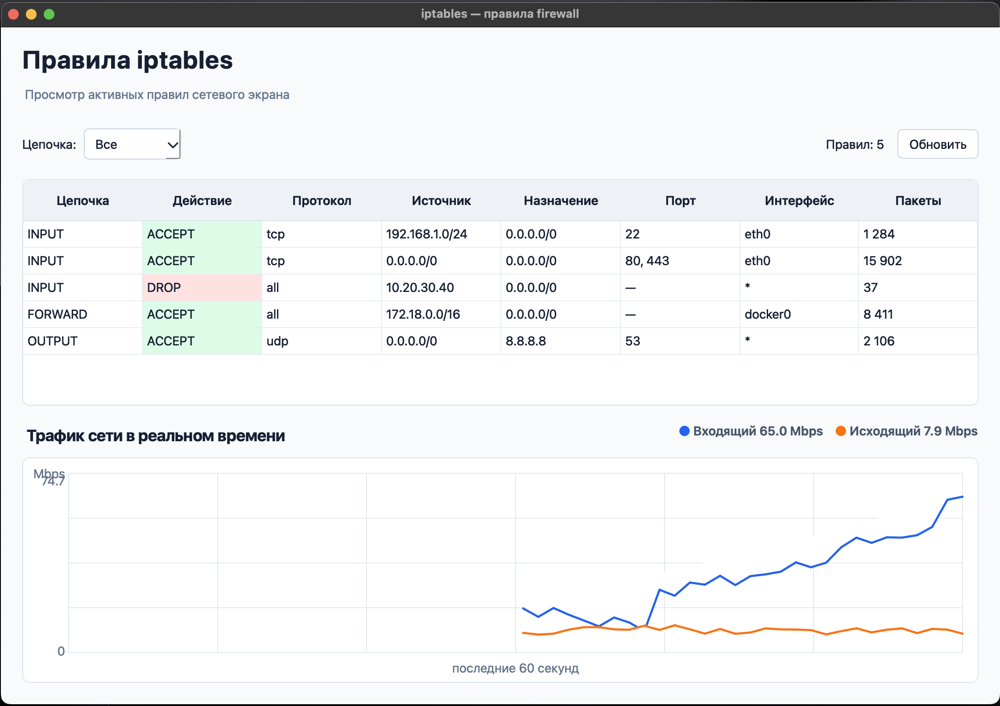

# iptables UI demo

Минимальное desktop-приложение на Qt 6 Widgets для просмотра правил iptables
и наблюдения за сетевым трафиком.

В демо есть:

- таблица правил с фильтром по цепочкам INPUT, FORWARD и OUTPUT;
- подсветка действий ACCEPT/DROP;
- realtime-график входящего и исходящего трафика за последние 60 секунд;
- текущие значения скорости в Mbps.

Трафик читается из системных счётчиков сетевых интерфейсов. Правила загружаются
командой `iptables-save -c` на Linux. На macOS график работает с реальными
данными, а таблица сообщает, что `iptables` в этой системе отсутствует.

## Интерфейс



## Сборка

```bash
cmake --preset local-qt
cmake --build --preset local-qt
./build/iptables-ui
```


